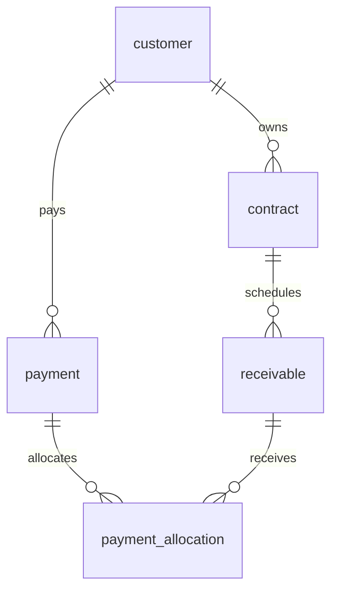

# 客户回款数据库系统：数据库与接口开发公约

> 版本：1.0（开发基线）\
> 适用范围：成员 A、成员 B、AI 辅助前端\
> 正式项目名称：客户回款数据库系统\
> 技术基线：Java 17 / Spring Boot 3.5.x / Maven / MySQL 8.0.16+\
> 本文是并行开发的共同契约。开始编码前由 A、B 确认；确认后，字段、路径、状态或金额口径的变更必须同步更新本文及代码。

本文优先于早期任务稿/报告设计稿；发生矛盾时以本文为准。DDL 已在独立 MySQL 8.4.7 临时实例中执行并验证基本约束；后端尚未实现，事务并发、接口和完整幂等流程需按验收清单运行验证。

## 1. 业务定义

本系统按“客户应收账款与实际回款核销管理”实现。业务关系为：客户签订合同，合同产生一笔或多笔应收款；客户发生实际到账后登记为回款；一笔回款可以核销到多笔应收款，一笔应收款也可由多笔回款逐次结清。

- **合同金额**是合同约定总额，不等同于当前应收余额。
- **应收金额**是按合同阶段建立的应收计划金额。
- **回款金额**是实际到账金额。
- **核销金额**是回款分配到某笔应收款的金额。
- **应收已收金额**只统计有效回款的核销明细，不以回款总额替代。
- **未分配回款**是到账金额减去其有效核销金额，单独统计，不冲减任一应收款。
- 本项目为教学规模的单体 Web 应用；全部金额为人民币 CNY，不含退款、坏账、银行自动对账、发票、审批、多租户和多币种。

## 2. 全局命名与数据约定

1. 数据库、表、列名使用小写 `snake_case`；API JSON 字段使用 `camelCase`；Java 字段使用 `camelCase`。
2. 主键统一为 `BIGINT AUTO_INCREMENT`，Java 使用正数 `Long`；JSON 中所有 ID 使用字符串（如 `"101"`），路径/查询也使用无前导零正十进制字符串，范围 `1..9223372036854775807`，避免浏览器整数精度损失。
3. 金额统一为 MySQL `DECIMAL(12,2)`、JSON 定点十进制字符串（如 `"5000.00"`）、Java `BigDecimal`；不允许使用 `FLOAT`、`DOUBLE` 或 Java `double` 存金额。
4. 日期采用 `YYYY-MM-DD`，不带时区；创建/更新时间在数据库采用 `DATETIME`，按应用统一时区存取。项目统一时区为 `Asia/Shanghai`，时间戳 JSON 格式为 `yyyy-MM-dd'T'HH:mm:ss+08:00`。
5. 所有表使用 InnoDB、`utf8mb4`；所有外键默认 `ON DELETE RESTRICT ON UPDATE RESTRICT`。历史业务不做级联物理删除。
6. 客户/合同/应收业务单号由调用方填写，回款单号由服务端产生；统一去首尾空格、转大写并保证唯一；数据库自增 ID 只作内部标识，不作为业务单号展示。
7. 业务记录不物理删除。客户/合同通过状态停用；回款通过作废状态冲销，保留原始记录与核销明细。
8. 列表分页 `page` 从 1 开始，默认 1；`size` 默认 20，最大 100；排序必须使用服务端白名单字段。
9. 表中 PK=主键、FK=外键、UK=唯一键、IDX=普通索引、AI=自增；字段字典空值“是”表示允许 SQL NULL。所有业务编号均限定为大写 ASCII 字母、数字和连字符，长度不得超过对应列。
10. V1 不含账号权限模块，仅用于本地受控课程演示；已有数据和历史回款仍需可读，不将客户停用等同于隐藏历史记录。后续加入认证时另立版本，并在鉴权后再执行幂等重放。

## 3. 表关系



| 父表 | 子表 | 关系 | 说明 |
| --- | --- | --- | --- |
| `customer` | `contract` | 1:N | 每份合同属于一个客户 |
| `contract` | `receivable` | 1:N | 应收款计划属于一份合同 |
| `customer` | `payment` | 1:N | 每笔回款记录一个付款客户 |
| `payment` | `payment_allocation` | 1:N | 回款可拆分核销 |
| `receivable` | `payment_allocation` | 1:N | 应收款可被分次收款 |

核销表是回款与应收款之间的关联实体，保存分配金额和时间。由于一张应收表通过合同追溯客户，服务层必须校验 `payment.customer_id` 与应收款所属合同的 `customer_id` 相同。

数据库共 **5 张业务表 + 1 张幂等技术表**；技术表 `api_idempotency` 不参与业务 ER 联系，避免为每个接口另造一套重复提交机制。

## 4. 关系模式与字段字典

### 4.1 `customer` 客户（A 负责）

| 字段 | 类型 | 空值 | 键/约束 | 说明 |
| --- | --- | --- | --- | --- |
| `id` | BIGINT | 否 | PK, AI | 内部主键 |
| `customer_no` | VARCHAR(32) | 否 | UK | 客户业务编号，创建后不可修改 |
| `name` | VARCHAR(120) | 否 | IDX | 客户/单位名称 |
| `contact_name` | VARCHAR(80) | 是 | - | 联系人 |
| `phone` | VARCHAR(32) | 是 | - | 联系电话，保留国家区号/分机格式 |
| `email` | VARCHAR(120) | 是 | - | 联系邮箱 |
| `address` | VARCHAR(255) | 是 | - | 地址 |
| `status` | VARCHAR(16) | 否 | ENUM 语义 | `ACTIVE` / `INACTIVE` |
| `note` | VARCHAR(500) | 是 | - | 备注 |
| `created_at` | DATETIME | 否 | 默认当前时间 | 创建时间 |
| `updated_at` | DATETIME | 否 | 自动更新 | 最后更新时间 |
| `version` | INT UNSIGNED | 否 | 默认 0 | 每次 A 模块修改成功后加 1，用于拒绝过期覆盖 |

### 4.2 `contract` 合同（A 负责）

| 字段 | 类型 | 空值 | 键/约束 | 说明 |
| --- | --- | --- | --- | --- |
| `id` | BIGINT | 否 | PK, AI | 内部主键 |
| `contract_no` | VARCHAR(40) | 否 | UK | 合同业务编号，创建后不可修改 |
| `customer_id` | BIGINT | 否 | FK → `customer.id`, IDX | 合同所属客户 |
| `name` | VARCHAR(160) | 否 | - | 合同名称 |
| `signed_date` | DATE | 是 | - | 签订日期 |
| `amount` | DECIMAL(12,2) | 否 | CHECK `> 0` | 合同金额 |
| `status` | VARCHAR(16) | 否 | ENUM 语义 | `ACTIVE` / `CANCELLED` |
| `note` | VARCHAR(500) | 是 | - | 备注 |
| `created_at` | DATETIME | 否 | 默认当前时间 | 创建时间 |
| `updated_at` | DATETIME | 否 | 自动更新 | 最后更新时间 |
| `version` | INT UNSIGNED | 否 | 默认 0 | 每次 A 模块修改成功后加 1，用于拒绝过期覆盖 |

### 4.3 `receivable` 应收款（A 负责）

| 字段 | 类型 | 空值 | 键/约束 | 说明 |
| --- | --- | --- | --- | --- |
| `id` | BIGINT | 否 | PK, AI | 内部主键 |
| `receivable_no` | VARCHAR(40) | 否 | UK | 应收业务编号，创建后不可修改 |
| `contract_id` | BIGINT | 否 | FK → `contract.id`, IDX | 所属合同 |
| `amount` | DECIMAL(12,2) | 否 | CHECK `> 0` | 应收金额 |
| `due_date` | DATE | 否 | 复合 IDX 第二列 | 到期日期，索引为 (contract_id, due_date) |
| `description` | VARCHAR(255) | 是 | - | 期次/节点说明 |
| `created_at` | DATETIME | 否 | 默认当前时间 | 创建时间 |
| `updated_at` | DATETIME | 否 | 自动更新 | 最后更新时间 |
| `version` | INT UNSIGNED | 否 | 默认 0 | 每次 A 模块修改成功后加 1，用于拒绝过期覆盖 |

应收 `status` 是派生收款状态，不入库：余额为 0 是 `PAID`，余额大于 0 且有效核销额大于 0 是 `PARTIAL`，核销额为 0 是 `UNPAID`。另返回 `overdue` 布尔值：`outstandingAmount > 0 AND dueDate < 上海时区当天日期`。部分收款也可能逾期，不能用单个互斥枚举掩盖这一情况。到期当天尚不算逾期。

### 4.4 `payment` 回款（B 负责）

| 字段 | 类型 | 空值 | 键/约束 | 说明 |
| --- | --- | --- | --- | --- |
| `id` | BIGINT | 否 | PK, AI | 内部主键 |
| `payment_no` | VARCHAR(40) | 否 | UK | 回款业务编号，创建后不可修改 |
| `customer_id` | BIGINT | 否 | FK → `customer.id`, IDX | 付款客户 |
| `payment_date` | DATE | 否 | 复合 IDX 第二列 | 实际到账日期，索引为 (customer_id, payment_date) |
| `amount` | DECIMAL(12,2) | 否 | CHECK `> 0` | 实际到账金额 |
| `method` | VARCHAR(24) | 否 | 枚举语义 | `BANK_TRANSFER` / `CASH` / `CHECK` / `OTHER` |
| `reference_no` | VARCHAR(80) | 是 | 历史原值 | 标准化流水号，作废后仍保留 |
| `active_reference_no` | VARCHAR(80) | 是 | 生成列, UK | ACTIVE 时等于 reference_no，否则 NULL；API 不输出 |
| `status` | VARCHAR(16) | 否 | 枚举语义 | `ACTIVE` / `VOID`，默认 `ACTIVE` |
| `note` | VARCHAR(500) | 是 | - | 原始备注 |
| `void_reason` | VARCHAR(500) | 是 | - | 作废时必填，原始备注不覆盖 |
| `voided_at` | DATETIME | 是 | - | 作废时间，正常时为 NULL |
| `created_at` | DATETIME | 否 | 默认当前时间 | 创建时间 |
| `updated_at` | DATETIME | 否 | 自动更新 | 最后更新时间 |

### 4.5 `payment_allocation` 核销明细（B 负责）

| 字段 | 类型 | 空值 | 键/约束 | 说明 |
| --- | --- | --- | --- | --- |
| `id` | BIGINT | 否 | PK, AI | 核销明细主键 |
| `payment_id` | BIGINT | 否 | FK → `payment.id`, IDX | 对应回款 |
| `receivable_id` | BIGINT | 否 | FK → `receivable.id`, IDX | 对应应收款 |
| `amount` | DECIMAL(12,2) | 否 | CHECK `> 0` | 本次核销金额 |
| `created_at` | DATETIME | 否 | 默认当前时间 | 核销创建时间 |

**不要**给 `(payment_id, receivable_id)` 加唯一约束：允许同一回款对同一应收分多次补充核销。单次请求出现重复应收 ID 则拒绝，由第 8 节的幂等机制防止网络重试造成重复行。

### 4.6 `api_idempotency` 幂等记录（B 负责）

| 字段 | 类型 | 空值 | 键/约束 | 说明 |
| --- | --- | --- | --- | --- |
| `request_key` | CHAR(36) ASCII | 否 | PK | 调用方生成的 UUID v4，小写标准格式，全接口唯一 |
| `http_method` | VARCHAR(8) ASCII | 否 | - | 此版本为 POST |
| `request_path` | VARCHAR(160) ASCII | 否 | - | 规范化路径，不含主机和查询串 |
| `request_hash` | CHAR(64) ASCII | 否 | - | 规范化请求体的 SHA-256 十六进制摘要 |
| `response_status` | SMALLINT UNSIGNED | 是 | - | 首次成功的 HTTP 状态码 |
| `response_body` | JSON | 是 | - | 首次成功响应的完整快照 |
| `created_at` | DATETIME | 否 | 默认当前时间 | 首次提交时间 |

`response_status`/`response_body` 只允许在尚未提交的事务中暂为 NULL，提交前必须补齐。失败请求连同该行整体回滚。V1 不自动清理幂等记录，以避免过期重放生成重复财务记录。

## 5. MySQL DDL 基线

最低使用 MySQL 8.0.16，确保 `CHECK` 实际生效；所有跨行/跨表业务规则仍须由服务层校验。A、B 合并为一份初始化脚本，按以下父子顺序建表。

```sql
CREATE DATABASE IF NOT EXISTS customer_receivables
  CHARACTER SET utf8mb4 COLLATE utf8mb4_0900_ai_ci;
USE customer_receivables;

CREATE TABLE customer (
  id BIGINT NOT NULL AUTO_INCREMENT,
  customer_no VARCHAR(32) NOT NULL,
  name VARCHAR(120) NOT NULL,
  contact_name VARCHAR(80) NULL,
  phone VARCHAR(32) NULL,
  email VARCHAR(120) NULL,
  address VARCHAR(255) NULL,
  status VARCHAR(16) NOT NULL DEFAULT 'ACTIVE',
  note VARCHAR(500) NULL,
  created_at DATETIME NOT NULL DEFAULT CURRENT_TIMESTAMP,
  updated_at DATETIME NOT NULL DEFAULT CURRENT_TIMESTAMP ON UPDATE CURRENT_TIMESTAMP,
  version INT UNSIGNED NOT NULL DEFAULT 0,
  PRIMARY KEY (id),
  UNIQUE KEY uk_customer_customer_no (customer_no),
  KEY idx_customer_name (name),
  CONSTRAINT chk_customer_status CHECK (status IN ('ACTIVE', 'INACTIVE'))
) ENGINE=InnoDB DEFAULT CHARSET=utf8mb4 COLLATE=utf8mb4_0900_ai_ci;

CREATE TABLE contract (
  id BIGINT NOT NULL AUTO_INCREMENT,
  contract_no VARCHAR(40) NOT NULL,
  customer_id BIGINT NOT NULL,
  name VARCHAR(160) NOT NULL,
  signed_date DATE NULL,
  amount DECIMAL(12,2) NOT NULL,
  status VARCHAR(16) NOT NULL DEFAULT 'ACTIVE',
  note VARCHAR(500) NULL,
  created_at DATETIME NOT NULL DEFAULT CURRENT_TIMESTAMP,
  updated_at DATETIME NOT NULL DEFAULT CURRENT_TIMESTAMP ON UPDATE CURRENT_TIMESTAMP,
  version INT UNSIGNED NOT NULL DEFAULT 0,
  PRIMARY KEY (id),
  UNIQUE KEY uk_contract_contract_no (contract_no),
  KEY idx_contract_customer_status (customer_id, status),
  CONSTRAINT fk_contract_customer FOREIGN KEY (customer_id) REFERENCES customer (id)
    ON DELETE RESTRICT ON UPDATE RESTRICT,
  CONSTRAINT chk_contract_amount CHECK (amount > 0),
  CONSTRAINT chk_contract_status CHECK (status IN ('ACTIVE', 'CANCELLED'))
) ENGINE=InnoDB DEFAULT CHARSET=utf8mb4 COLLATE=utf8mb4_0900_ai_ci;

CREATE TABLE receivable (
  id BIGINT NOT NULL AUTO_INCREMENT,
  receivable_no VARCHAR(40) NOT NULL,
  contract_id BIGINT NOT NULL,
  amount DECIMAL(12,2) NOT NULL,
  due_date DATE NOT NULL,
  description VARCHAR(255) NULL,
  created_at DATETIME NOT NULL DEFAULT CURRENT_TIMESTAMP,
  updated_at DATETIME NOT NULL DEFAULT CURRENT_TIMESTAMP ON UPDATE CURRENT_TIMESTAMP,
  version INT UNSIGNED NOT NULL DEFAULT 0,
  PRIMARY KEY (id),
  UNIQUE KEY uk_receivable_receivable_no (receivable_no),
  KEY idx_receivable_contract_due (contract_id, due_date),
  CONSTRAINT fk_receivable_contract FOREIGN KEY (contract_id) REFERENCES contract (id)
    ON DELETE RESTRICT ON UPDATE RESTRICT,
  CONSTRAINT chk_receivable_amount CHECK (amount > 0)
) ENGINE=InnoDB DEFAULT CHARSET=utf8mb4 COLLATE=utf8mb4_0900_ai_ci;

CREATE TABLE payment (
  id BIGINT NOT NULL AUTO_INCREMENT,
  payment_no VARCHAR(40) NOT NULL,
  customer_id BIGINT NOT NULL,
  payment_date DATE NOT NULL,
  amount DECIMAL(12,2) NOT NULL,
  method VARCHAR(24) NOT NULL,
  reference_no VARCHAR(80) NULL,
  status VARCHAR(16) NOT NULL DEFAULT 'ACTIVE',
  active_reference_no VARCHAR(80) GENERATED ALWAYS AS
    (CASE WHEN status = 'ACTIVE' THEN reference_no ELSE NULL END) STORED,
  note VARCHAR(500) NULL,
  void_reason VARCHAR(500) NULL,
  voided_at DATETIME NULL,
  created_at DATETIME NOT NULL DEFAULT CURRENT_TIMESTAMP,
  updated_at DATETIME NOT NULL DEFAULT CURRENT_TIMESTAMP ON UPDATE CURRENT_TIMESTAMP,
  PRIMARY KEY (id),
  UNIQUE KEY uk_payment_payment_no (payment_no),
  UNIQUE KEY uk_payment_active_reference_no (active_reference_no),
  KEY idx_payment_customer_date (customer_id, payment_date),
  CONSTRAINT fk_payment_customer FOREIGN KEY (customer_id) REFERENCES customer (id)
    ON DELETE RESTRICT ON UPDATE RESTRICT,
  CONSTRAINT chk_payment_amount CHECK (amount > 0),
  CONSTRAINT chk_payment_method CHECK (method IN ('BANK_TRANSFER', 'CASH', 'CHECK', 'OTHER')),
  CONSTRAINT chk_payment_status CHECK (status IN ('ACTIVE', 'VOID')),
  CONSTRAINT chk_payment_void CHECK (
    (status = 'ACTIVE' AND void_reason IS NULL AND voided_at IS NULL) OR
    (status = 'VOID' AND void_reason IS NOT NULL AND voided_at IS NOT NULL)
  )
) ENGINE=InnoDB DEFAULT CHARSET=utf8mb4 COLLATE=utf8mb4_0900_ai_ci;

CREATE TABLE payment_allocation (
  id BIGINT NOT NULL AUTO_INCREMENT,
  payment_id BIGINT NOT NULL,
  receivable_id BIGINT NOT NULL,
  amount DECIMAL(12,2) NOT NULL,
  created_at DATETIME NOT NULL DEFAULT CURRENT_TIMESTAMP,
  PRIMARY KEY (id),
  KEY idx_allocation_payment (payment_id),
  KEY idx_allocation_receivable (receivable_id),
  CONSTRAINT fk_allocation_payment FOREIGN KEY (payment_id) REFERENCES payment (id)
    ON DELETE RESTRICT ON UPDATE RESTRICT,
  CONSTRAINT fk_allocation_receivable FOREIGN KEY (receivable_id) REFERENCES receivable (id)
    ON DELETE RESTRICT ON UPDATE RESTRICT,
  CONSTRAINT chk_allocation_amount CHECK (amount > 0)
) ENGINE=InnoDB DEFAULT CHARSET=utf8mb4 COLLATE=utf8mb4_0900_ai_ci;

CREATE TABLE api_idempotency (
  request_key CHAR(36) CHARACTER SET ascii COLLATE ascii_bin NOT NULL,
  http_method VARCHAR(8) CHARACTER SET ascii COLLATE ascii_bin NOT NULL,
  request_path VARCHAR(160) CHARACTER SET ascii COLLATE ascii_bin NOT NULL,
  request_hash CHAR(64) CHARACTER SET ascii COLLATE ascii_bin NOT NULL,
  response_status SMALLINT UNSIGNED NULL,
  response_body JSON NULL,
  created_at DATETIME NOT NULL DEFAULT CURRENT_TIMESTAMP,
  PRIMARY KEY (request_key)
) ENGINE=InnoDB DEFAULT CHARSET=utf8mb4 COLLATE=utf8mb4_0900_ai_ci;
```

`utf8mb4_0900_ai_ci` 和生效的 CHECK 是本基线要求；双方统一使用 MySQL 8.0.16+，不按 MySQL 5.7 实现。生产代码使用 Flyway/Liquibase 时，以上结构放入版本迁移脚本，避免运行期自动改表。

## 6. 金额与状态计算口径

对于有效回款（`payment.status = 'ACTIVE'`）：

```text
应收已收金额 = SUM(该 receivable 的 allocation.amount，且对应 payment.status = ACTIVE)
应收未收余额 = receivable.amount - 应收已收金额
回款已核销金额 = SUM(该 payment 的 allocation.amount)
回款未分配金额 = payment.amount - 回款已核销金额
```

- 汇总金额必须使用数据库 `DECIMAL` 聚合并映射为 `BigDecimal`。
- 所有输出金额保留两位小数；输入必须是两位小数的字符串，范围为 `"0.01"` 至 `"9999999999.99"`，禁止科学计数法、千位分隔符和静默四舍五入。汇总值可超过单条上限，仍以两位小数字符串返回。
- 应收余额理论上不得小于 0；若出现负值视为数据一致性错误，不用 `max(0, ...)` 掩盖。
- 系统总“实收”统计有效回款总额；系统总“已核销”统计有效核销额；系统“未分配回款”统计有效回款余额；系统“未收应收”统计应收余额。四者口径不能混用。
- 合同应收合计必须不超过合同金额。V1 不支持超额应收。新增/调整应收或合同金额时，服务端校验同一合同应收金额合计不超过合同金额，按第 8 节串行加锁。

## 7. REST API 契约

### 7.1 公共请求与响应

- Base URL `/api`，JSON UTF-8；`?` 表示可选参数。所有响应的 `code` 使用字符串，废止旧稿中的数字 `0`。
- 所有 ID 是 JSON 字符串，金额为两位小数字符串，`page`/`size`/`total`/`version` 为 JSON 整数，`overdue` 为布尔值。
- 成功包络：`{"code":"OK","message":"success","data":...}`；错误包络：`{"code":"VALIDATION_ERROR","message":"金额格式不正确","data":{"field":"amount"}}`。没有字段明细时 `data: null`，禁止向页面返回 SQL 或堆栈。
- 客户/合同/应收/回款新建成功为 HTTP 201；查询、PUT、PATCH、追加核销、作废成功为 200；错误见第 9 节，不能将所有错误伪装为 200。
- 分页 `data` 为 `{"items":[],"page":1,"size":20,"total":0}`。默认 page=1、size=20，size 范围 1..100；空页保留 total，不返回 404。
- 列表筛选条件组合为 AND；客户/合同 `keyword` 是编号或名称包含匹配；回款 `keyword` 是回款编号或流水号包含匹配。LIKE 查询的 `%`、`_` 必须作为普通输入转义，使用参数绑定。
- 客户/合同/应收列表固定 `id DESC`，回款列表固定 `payment_date DESC, id DESC`；V1 不接受自定义排序参数。未知字段、参数或枚举返回 400。
- 可选文本先 trim，空串规范化为 NULL；必填文本不可为空，字段长度以字典为上限，禁止静默截断。邮箱有值时校验邮箱格式；电话允许数字、空格、`+()-`，长度遵循字典。
- POST 的可选字段省略视为 NULL；PUT 是可编辑字段整体替换，可选字段省略或 null 表示清空，必填字段缺失/null 为 400。状态、ID、创建/更新时间等只读属性禁止在请求中伪造。
- 业务编号规范：客户/合同/应收编号由调用方填写并 trim、转大写，只允许 `[A-Z0-9-]+`；创建后不可修改。回款编号服务端生成 `PAY-` + UUID 去连字符后转大写，长度 36，由唯一键兜底，客户端不得填写。
- 流水号可空；有值时 trim、转大写，以 ASCII 字母/数字和 `-_/` 组成，最多 80 字符。仅 ACTIVE 回款之间必须唯一；作废释放唯一占用并保留原值。
- 所有日期是严格有效的 `yyyy-MM-dd`。允许应收日期在过去；到账日期不晚于上海时区当天。日期区间两端包含，`from > to` 返回 400；每日趋势最多查询连续 366 天。
- 客户/合同/应收创建时 `version=0`；对应 PUT/PATCH 必填 version，成功后加 1，过期时 409。B 核销/作废只改变派生金额，不修改 A 的 version。
- V1 的 POST 回款、POST 追加核销、POST 作废必须带 `Idempotency-Key: <UUID v4>`，实现见第 8 节。

### 7.2 客户 API（A）

| 方法/路径 | 请求参数 | 成功 `data` |
| --- | --- | --- |
| `GET /api/customers` | `keyword?`, `status?`, `page?`, `size?` | Customer 分页 |
| `POST /api/customers` | `customerNo`, `name`, `contactName?`, `phone?`, `email?`, `address?`, `note?` | Customer |
| `GET /api/customers/{id}` | 路径正整数 ID | Customer |
| `PUT /api/customers/{id}` | `version`, `name`, `contactName?`, `phone?`, `email?`, `address?`, `note?` | Customer |
| `PATCH /api/customers/{id}/status` | `version`, `status` (`ACTIVE` 或 `INACTIVE`) | Customer |

Customer 字段：`id`, `customerNo`, `name`, `contactName`, `phone`, `email`, `address`, `status`, `note`, `createdAt`, `updatedAt`, `version`。状态初始 ACTIVE；停用/启用可往返，重复设置当前状态返回 409 STATE_CONFLICT。

客户停用后允许查看全部历史、对已有有效回款继续核销或作废；禁止新建合同、应收和回款。停用不清除数据，不阻止历史欠款查询。

### 7.3 合同 API（A）

| 方法/路径 | 请求参数 | 成功 `data` |
| --- | --- | --- |
| `GET /api/contracts` | `customerId?`, `status?`, `keyword?`, `page?`, `size?` | Contract 分页 |
| `POST /api/contracts` | `contractNo`, `customerId`, `name`, `signedDate?`, `amount`, `note?` | Contract |
| `GET /api/contracts/{id}` | 路径 ID | Contract |
| `PUT /api/contracts/{id}` | `version`, `name`, `signedDate?`, `amount`, `note?` | Contract |
| `PATCH /api/contracts/{id}/status` | `version`, `status`（只接受 `CANCELLED`） | Contract |

Contract 字段：`id`, `contractNo`, `customerId`, `customerName`, `name`, `signedDate`, `amount`, `status`, `note`, `createdAt`, `updatedAt`, `version`。

`customerId`/`contractNo` 始终不可修改。创建状态 ACTIVE；仅尚无任何应收记录的 ACTIVE 合同可取消，取消后不可恢复、编辑或新增应收。修改合同金额后必须仍满足该合同应收金额总和不超过合同金额，允许增加金额。合同“收清”由数据汇总判断，不另设 COMPLETED 存储状态。

### 7.4 应收款 API（A）

| 方法/路径 | 请求参数 | 成功 `data` |
| --- | --- | --- |
| `GET /api/receivables` | `customerId?`, `contractId?`, `status?`, `overdue?`, `dueFrom?`, `dueTo?`, `page?`, `size?` | Receivable 分页 |
| `POST /api/receivables` | `receivableNo`, `contractId`, `amount`, `dueDate`, `description?` | Receivable |
| `GET /api/receivables/{id}` | 路径 ID | Receivable |
| `PUT /api/receivables/{id}` | `version`, `amount`, `dueDate`, `description?` | Receivable |

Receivable 字段：`id`, `receivableNo`, `contractId`, `contractNo`, `customerId`, `customerName`, `amount`, `receivedAmount`, `outstandingAmount`, `dueDate`, `description`, `status`, `overdue`, `createdAt`, `updatedAt`, `version`。`status` 只接受 UNPAID/PARTIAL/PAID；`overdue` 只接受 true/false，不传则不筛选。

创建需客户 ACTIVE 且合同 ACTIVE；编辑不允许变更合同归属/业务编号。没有任何核销历史时允许修改 amount/dueDate，仍须满足合同总额约束；有核销历史时（包括作废回款留下的明细）两字段锁定，仅可修改 description 并携带原金额/日期。V1 不提供应收物理删除/冲正接口。

```json
{
  "id": "101",
  "receivableNo": "AR-2026-0001",
  "contractId": "21",
  "contractNo": "CT-2026-001",
  "customerId": "7",
  "customerName": "示例客户",
  "amount": "10000.00",
  "receivedAmount": "3000.00",
  "outstandingAmount": "7000.00",
  "dueDate": "2026-12-31",
  "description": "一期应收",
  "status": "PARTIAL",
  "overdue": false,
  "createdAt": "2026-11-11T10:00:00+08:00",
  "updatedAt": "2026-11-11T10:00:00+08:00",
  "version": 0
}
```

### 7.5 回款和核销 API（B）

| 方法/路径 | 请求参数 | 成功 `data` |
| --- | --- | --- |
| `GET /api/payments` | `customerId?`, `dateFrom?`, `dateTo?`, `method?`, `status?`, `keyword?`, `page?`, `size?` | Payment 分页（无 allocations 数组） |
| `POST /api/payments` | 下方 JSON + 幂等头 | PaymentDetail，HTTP 201 |
| `GET /api/payments/{id}` | 路径 ID | PaymentDetail |
| `POST /api/payments/{id}/allocations` | `{"allocations":[{"receivableId":"101","amount":"100.00"}]}` + 幂等头 | PaymentDetail，HTTP 200 |
| `POST /api/payments/{id}/void` | `{"reason":"重复登记"}` + 幂等头 | PaymentDetail，HTTP 200 |

回款查询 `status` 只接受 ACTIVE/VOID，不传返回两类；统计只纳入 ACTIVE。V1 对所有回款都不提供 PUT/PATCH 普通编辑和 DELETE 物理删除；登记错误通过作废后重新登记纠正。

新建回款请求：

```json
{
  "customerId": "7",
  "paymentDate": "2026-11-11",
  "amount": "5000.00",
  "method": "BANK_TRANSFER",
  "referenceNo": "BANK-20261111-001",
  "note": "一期到账",
  "allocations": [
    { "receivableId": "101", "amount": "3000.00" },
    { "receivableId": "102", "amount": "1500.00" }
  ]
}
```

创建时 allocations 可省略/空数组，表示未分配；禁止 null。追加核销时该数组必填、至少 1 行；单请求最多 100 行，重复 receivableId 拒绝，不自动合并。每行仅接受 receivableId、amount。回款不能跨客户核销，但可核销到同一客户的不同合同。

Payment 字段：`id`, `paymentNo`, `customerId`, `customerName`, `paymentDate`, `amount`, `method`, `referenceNo`, `status`, `note`, `voidReason`, `voidedAt`, `allocatedAmount`, `unallocatedAmount`, `createdAt`, `updatedAt`。

PaymentDetail 额外包含 `allocations`，按明细 id 升序返回所有历史核销行，每行是 `id`, `receivableId`, `receivableNo`, `amount`, `createdAt`；不在明细行额外返回“本次写入后的余额”，需要时调用应收查询。示例成功响应：

```json
{
  "code": "OK",
  "message": "success",
  "data": {
    "id": "501",
    "paymentNo": "PAY-A31D3F50D21E4C0EA32AFB09BA89F124",
    "customerId": "7",
    "customerName": "示例客户",
    "paymentDate": "2026-11-11",
    "amount": "5000.00",
    "method": "BANK_TRANSFER",
    "referenceNo": "BANK-20261111-001",
    "status": "ACTIVE",
    "note": "一期到账",
    "voidReason": null,
    "voidedAt": null,
    "allocatedAmount": "4500.00",
    "unallocatedAmount": "500.00",
    "createdAt": "2026-11-11T10:30:00+08:00",
    "updatedAt": "2026-11-11T10:30:00+08:00",
    "allocations": [
      {"id":"801","receivableId":"101","receivableNo":"AR-2026-0001","amount":"3000.00","createdAt":"2026-11-11T10:30:00+08:00"},
      {"id":"802","receivableId":"102","receivableNo":"AR-2026-0002","amount":"1500.00","createdAt":"2026-11-11T10:30:00+08:00"}
    ]
  }
}
```

VOID 回款的 `allocatedAmount`/`unallocatedAmount` 均返回 `"0.00"`，原始 amount 和 allocations 保留用于历史展示，均不参与有效统计。作废原因 trim 后必填，最多 500 字符；voidedAt 为作废事务时间。作废不可撤销，不能向 VOID 回款追加核销。

### 7.6 统计 API（B）

| 方法/路径 | 参数 | 成功 `data` |
| --- | --- | --- |
| `GET /api/reports/summary` | 无日期筛选 | 当前系统汇总对象 |
| `GET /api/reports/customers/{customerId}` | 路径 ID | 当前客户汇总对象，另含 customerId/customerName |
| `GET /api/reports/payments/daily` | 必填 dateFrom/dateTo；可选 customerId | 每日回款数组，含区间内每一天，未到账日填零 |

系统/客户汇总对象包含：

| 字段 | 精确口径 |
| --- | --- |
| `asOfDate` | 上海时区查询当天日期，只表示当前快照，不能用于历史重建 |
| `contractAmount` | ACTIVE 合同金额总和 |
| `receivableAmount` | 全部应收金额总和（合同仅无应收时才能取消） |
| `receivedAmount` | ACTIVE 回款到账金额总和 |
| `allocatedAmount` | ACTIVE 回款的核销金额总和 |
| `outstandingAmount` | receivableAmount - allocatedAmount |
| `unallocatedAmount` | receivedAmount - allocatedAmount |
| `overdueAmount` | 余额>0 且到期日早于当天的应收余额总和 |

客户停用不影响历史统计。无数据的每项金额返回 `"0.00"`。SQL 必须先分别聚合应收与回款/核销，再组合，禁止直接多表 JOIN 后 SUM 导致笛卡尔重复累计；跨多个 SQL 的报表在同一只读一致性快照事务中查询。

每日趋势只返回 `[{"date":"2026-11-11","receivedAmount":"5000.00","paymentCount":1}]`，按日期升序，统计当前仍 ACTIVE 且到账日在区间内的回款。V1 不把“按到账日统计”误称为“当日发生的核销额”，不提供历史时点欠款报表。后续作废会改变过去到账日的当前有效趋势，这是明确的当前有效口径。

## 8. 事务、并发与幂等

### 8.1 A/B 必须共用的写锁规则

为保持教学实现简单可靠，采用**客户行作为该客户全部财务写入的串行化点**，不依赖 A/B 各自猜测锁法。

1. 客户创建以外的所有业务写入先确定不可变客户归属，开启 `@Transactional(isolation = READ_COMMITTED, rollbackFor = Exception.class)`，然后 `SELECT id FROM customer WHERE id = ? FOR UPDATE`。在取得客户锁之前不得读取余额或做更新。
2. 已有合同/应收/回款的客户归属不可修改，可先读归属定位客户，取得锁后重新读业务记录校验存在和状态。目标应收不属于该客户时直接拒绝，不继续锁第二个客户。
3. 客户锁必须覆盖：A 的客户资料/状态修改、合同创建/修改/取消、应收创建/修改；B 的回款创建、追加核销和作废。一次请求只修改一个客户的数据。
4. 获得客户锁后，若再锁子记录，统一顺序为合同 ID 升序 → 应收 ID 升序 → 回款 ID 升序。事务必须短，不在锁内等待前端、外部服务或人工确认。
5. `READ_COMMITTED` 保证获得锁后汇总读到最新提交结果；若使用其他隔离级别必须重新证明快照不陈旧，不能直接照搬默认 REPEATABLE_READ 下的旧快照。
6. A 的 version 使用比较更新；过期版本报 `409 STALE_VERSION`，成功修改其版本加 1。B 核销改变派生余额，不改变 A 的 version；金额保护仍通过锁内核销历史校验保证。
7. 死锁/锁等待超时必须整体回滚，返回 `503 RETRYABLE_CONFLICT`；不得只重试事务内部分 SQL。财务客户端重试使用同一幂等键。

A 提供公共辅助方法 `CustomerWriteLock.lock(long customerId)`：只能在已开启的写事务内调用，执行上面的客户行锁；不存在则抛 RESOURCE_NOT_FOUND。B 可直接查询 A 归属的只读表和核销余额，不通过 HTTP 调同一单体的内部 API；B 不直接修改 A 的业务字段。A/B 共同维护 `ReceivableBalanceQuery` 的 SQL 口径，具体 Java 类归属可放 common 包。

### 8.2 创建回款 / 追加核销

1. 先按 8.4 占用幂等键；成功的历史重试先重放，不按当前余额重复执行。
2. 创建回款要求客户 ACTIVE；追加核销允许客户已停用，但回款/目标合同仍须 ACTIVE。全部目标应收必须通过合同属于同一客户。
3. 锁内校验字段、重复行、金额范围和当前余额：`本次分配合计 <= 回款金额-原有效分配额`，每一行 `<= 该应收当前余额`。禁止把先前从前端取得的余额当校验依据。
4. 创建回款时生成回款编号；写 payment 和所有 allocation。追加核销只新增明细，并更新 payment.updated_at。不覆盖旧明细。
5. 保存成功响应快照及状态后一次提交；任意异常连同业务和幂等行一起回滚。零分配允许创建，追加核销不允许空数组。

### 8.3 作废和历史保护

- 作废取得客户锁后，校验 payment 为 ACTIVE，将 status 改为 VOID，同时设置 void_reason/voided_at/updated_at。原始 amount、note、reference_no、核销明细不改。
- 正常汇总过滤 payment.status=ACTIVE，作废因此恢复所有相关应收的余额；更新多个缓存余额的方案不在本基线内。
- 作废后可用同一 referenceNo 重新创建正确回款，数据库只对 ACTIVE 流水号做唯一限制。
- 新幂等键再次作废 VOID 回款返回 409 PAYMENT_VOID；原幂等键的网络重试重放首次成功结果。
- 有任何核销历史的应收 amount/due_date 均不可改；无核销历史时可改，但始终校验合同应收合计<=合同金额。所有关联主键一经创建不可改。
- V1 不支持单条核销撤回、退款、删除应收或减少已收合同。回款分配错误先作废该整笔回款，再按原到账金额重新登记正确分配；两个操作各自原子，不宣称它们合成一个跨请求事务。

### 8.4 必须落库的幂等机制

- 三个 B 的写接口均必填 Idempotency-Key，值为标准 UUID v4，服务端校验并转小写。同一次业务操作重试复用原键，不同操作使用新键；同一键跨所有路由唯一。
- 占用键在业务事务开头执行 INSERT api_idempotency（response_status/body 暂 NULL），然后才锁客户。重复键会等待首次事务提交或回滚，不可仅用“先查后插”防重。
- 请求摘要为规范化 JSON 的 SHA-256：递归按对象 key 排序，保留数组顺序/字符串原值，去除无意义空白；比较时同时比较 http_method、规范化路由实际路径、request_hash。路径 ID 用无前导零十进制形式。
- 重复 INSERT 报唯一键后，先回滚该重试事务，再在新的只读事务中读成功记录：方法/路径/摘要相同则返回存档 response_status/body，任何差异返回 409 IDEMPOTENCY_CONFLICT。严禁捕获 Spring 已标记回滚的事务异常后继续写入。
- 新请求执行业务，并在同一事务提交前填充 response_status 和完整响应 JSON；任何失败不保留幂等记录。V1 不清理成功幂等记录。
- 重放返回的是首次成功快照，可能与后续作废/核销后的现状不同；前端完成写操作或重放后重新 GET 查询应收/回款/汇总，取当前状态。

## 9. API 参数、字段及错误校验

| 场景 | 处理规则 |
| --- | --- |
| 金额为空、为 0 或负数 | `400 VALIDATION_ERROR` |
| 金额不是两位小数字符串 / 超范围 / 重复核销行 / 缺失幂等键 | `400 VALIDATION_ERROR` |
| 客户/合同/应收/回款不存在 | `404 RESOURCE_NOT_FOUND` |
| 停用客户创建合同/应收/回款 | `409 CUSTOMER_INACTIVE` |
| 回款客户与应收所属客户不一致 | `409 CUSTOMER_MISMATCH` |
| 核销合计超过回款金额 | `409 ALLOCATION_EXCEEDS_PAYMENT` |
| 核销金额超过应收剩余余额 | `409 ALLOCATION_EXCEEDS_RECEIVABLE` |
| 重复业务编号或有效流水号 | `409 DUPLICATE_BUSINESS_NO` |
| 修改有核销历史应收的金额/日期 | `409 RECEIVABLE_LOCKED` |
| 合同金额小于应收合计 / 新应收导致超合同额 | `409 CONTRACT_AMOUNT_EXCEEDED` |
| 操作取消合同或已有应收合同的取消 | `409 CONTRACT_STATE_CONFLICT` |
| A 的 version 过期 | `409 STALE_VERSION` |
| 重复设置客户当前状态 | `409 STATE_CONFLICT` |
| 幂等键内容/路径冲突 | `409 IDEMPOTENCY_CONFLICT` |
| 锁等待超时 / 死锁整体回滚 | `503 RETRYABLE_CONFLICT` |
| 作废/修改已作废回款 | `409 PAYMENT_VOID` |
| 分页 `page < 1` 或 `size` 不在 1..100 | `400 VALIDATION_ERROR` |
| 日期区间起始晚于结束 | `400 VALIDATION_ERROR` |

## 10. A/B 模块边界与文件协作

- **A 拥有：** `customer`、`contract`、`receivable` 表、对应 DDL/迁移、实体/Repository/Service/Controller、数据字典前半部分及客户/合同/应收测试。
- **B 拥有：** `payment`、`payment_allocation`、`api_idempotency` 表、对应 DDL/迁移、回款/核销/报表实体和接口、事务规则及测试。
- **共同拥有：** API 错误格式、响应包络、统一初始化/迁移顺序、演示数据、README、端到端测试和报告中的最终数据库图。
- A/B 可并行实现各自模块，但先确认本公约第 4、5、7 节；提交前由 A/B 一起从空 MySQL 实例执行迁移脚本。
- 工程结构：一个 Spring Boot 单体、一个 Maven 构建、一个 MySQL 数据库；模块包建议 common/customer/contract/receivable/payment/report。A 整合项目骨架和三张 A 表，B 提供三个 B 表（含技术表）及模块，不各自另建不兼容项目。
- DDL 只维护一套正式迁移；不要分别保留互不兼容的 `schema.sql`。建议后端项目采用 Flyway，按 `V1__core_tables.sql`、`V2__payment_tables.sql` 顺序维护。
- API DTO 的属性以本文 JSON 字段为准；JPA 实体可采用不同 Java 类型/命名，但序列化结果必须符合 API 契约。
- 每次契约变更需同步报告中的数据字典、测试用例、Mermaid ER 图及 AI 前端提示/实现。

## 11. 联调样例与最低验收清单

### 11.1 可手工核对的基准场景

客户 C-001，合同 CT-001 金额 `"15000.00"`；应收 AR-001 为 `"10000.00"`，AR-002 为 `"5000.00"`，到期日均为未来日期。登记一笔 `"5000.00"` 回款，分别核销 `"3000.00"` 和 `"1500.00"`。

| 指标 | 回款前 | 回款并核销后 | 作废该回款后 |
| --- | --- | --- | --- |
| 应收总额 | 15000.00 | 15000.00 | 15000.00 |
| 有效到账总额 | 0.00 | 5000.00 | 0.00 |
| 有效核销总额 | 0.00 | 4500.00 | 0.00 |
| 未收应收总额 | 15000.00 | 10500.00 | 15000.00 |
| 未分配回款 | 0.00 | 500.00 | 0.00 |
| AR-001 余额 | 10000.00 | 7000.00 | 10000.00 |
| AR-002 余额 | 5000.00 | 3500.00 | 5000.00 |

表内金额为展示文本；API 均返回两位小数字符串。作废后两条核销明细保留，但有效核销汇总为零。

### 11.2 数据库与服务层各自保证的范围

| 规则 | 数据库强制保证 | 服务层在事务内保证 |
| --- | --- | --- |
| 主键、外键、业务单号及有效流水号唯一 | 是 | 同时提供可读错误提示 |
| 单行金额 > 0、状态/方式枚举、作废审计字段 | CHECK | 必须再次校验输入 |
| 同客户归属、核销不超回款/应收、应收不超合同 | 单独 FK/CHECK 无法覆盖跨行合计 | 必须，在客户写锁内检查 |
| 防止并发核销、过期覆盖、重复网络提交 | 行锁/版本条件/幂等键主键提供基础机制 | 必须按第 8 节完整使用 |
| 有核销历史不改金额/日期、不物理删除 | FK 只能保护有关联的部分删除 | V1 API 禁止删除并强制执行历史保护 |

客户端校验只用于提示，不能替代上述两层。应用数据库账号只授予运行所需 DML，变更表结构使用迁移账号；禁止在运行中 `ddl-auto=update/create` 覆盖正式结构，ORM 可用 `validate`。

### 11.3 已执行的 DDL 核验范围

2026-11-11，在隔离的临时 MySQL 8.4.7 实例中已执行本文 SQL，验证了六表创建、金额正值 CHECK、FK、不重复业务单号、不重复 ACTIVE 流水号、作废审计 CHECK，以及作废后余额恢复、核销历史保留、流水号可重新登记。临时实例已关闭。本次未实现或验证 Java 接口、并发请求及幂等服务逻辑；以下清单用于开发完成后验收。

### 11.4 开发完成后验收


- [ ] 在 MySQL 8.0.16+ 空库执行全部迁移成功，六张表的外键、唯一键、CHECK 约束有效。
- [ ] 一客户、一合同、两笔应收、一笔回款跨应收核销的端到端示例可运行。
- [ ] 支持部分核销、未分配回款、多次回款结清同一应收款。
- [ ] 超回款核销、超应收余额核销、跨客户核销均失败且无部分写入。
- [ ] 并发核销不会造成应收余额为负或累计核销超过应收金额。
- [ ] 作废回款保留审计历史，相关应收余额和报表按约定恢复。
- [ ] 列表分页、过滤和金额汇总使用同一业务口径。
- [ ] 同键同请求重放无重复写入；同键异请求 409；财务写入失败幂等行同时回滚。
- [ ] A 改应收金额与 B 核销并发时仍满足金额约束，过期版本不覆盖。
- [ ] 部分回款且逾期时 status=PARTIAL、overdue=true，两个字段互不覆盖。
- [ ] 作废后保留流水号历史，并允许新 ACTIVE 回款复用该流水号。
- [ ] API 错误包络可供 AI 前端直接展示；金额业务校验始终由服务端强制执行。
- [ ] 课程报告的数据字典、ER 图、流程图与最终 DDL/API 一致。

## 12. 变更确认记录

| 版本 | 日期 | 变更 | A 确认 | B 确认 |
| --- | --- | --- | --- | --- |
| 1.0 | 2026-11-11 | 建立数据库、金额、状态、事务及 REST API 基线 | 待确认 | 待确认 |
