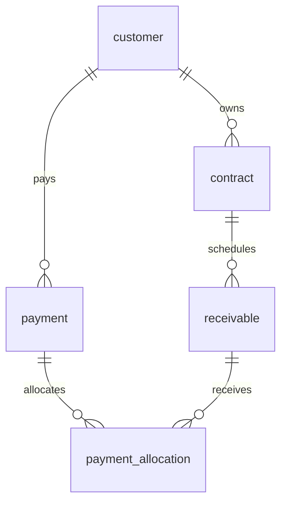

# 数据字典与关系模式

以下内容同步自 [数据库与接口开发公约](../任务规划/数据库与接口开发公约.md) v1.0；最终实施后须与实际迁移脚本核对。本文不取代该公约，转发开发约定请直接使用公约全文。

## 3. 表关系

| 父表 | 子表 | 关系 | 说明 |
| --- | --- | --- | --- |
| `customer` | `contract` | 1:N | 每份合同属于一个客户 |
| `contract` | `receivable` | 1:N | 应收款计划属于一份合同 |
| `customer` | `payment` | 1:N | 每笔回款记录一个付款客户 |
| `payment` | `payment_allocation` | 1:N | 回款可拆分核销 |
| `receivable` | `payment_allocation` | 1:N | 应收款可被分次收款 |

核销表是回款与应收款之间的关联实体，保存分配金额和时间。由于一张应收表通过合同追溯客户，服务层必须校验 `payment.customer_id` 与应收款所属合同的 `customer_id` 相同。

数据库共 **5 张业务表 + 1 张幂等技术表**；技术表 `api_idempotency` 不参与业务 ER 联系，避免为每个接口另造一套重复提交机制。

## 4. 关系模式与字段字典

### 4.1 `customer` 客户（A 负责）

| 字段 | 类型 | 空值 | 键/约束 | 说明 |
| --- | --- | --- | --- | --- |
| `id` | BIGINT | 否 | PK, AI | 内部主键 |
| `customer_no` | VARCHAR(32) | 否 | UK | 客户业务编号，创建后不可修改 |
| `name` | VARCHAR(120) | 否 | IDX | 客户/单位名称 |
| `contact_name` | VARCHAR(80) | 是 | - | 联系人 |
| `phone` | VARCHAR(32) | 是 | - | 联系电话，保留国家区号/分机格式 |
| `email` | VARCHAR(120) | 是 | - | 联系邮箱 |
| `address` | VARCHAR(255) | 是 | - | 地址 |
| `status` | VARCHAR(16) | 否 | ENUM 语义 | `ACTIVE` / `INACTIVE` |
| `note` | VARCHAR(500) | 是 | - | 备注 |
| `created_at` | DATETIME | 否 | 默认当前时间 | 创建时间 |
| `updated_at` | DATETIME | 否 | 自动更新 | 最后更新时间 |
| `version` | INT UNSIGNED | 否 | 默认 0 | 每次 A 模块修改成功后加 1，用于拒绝过期覆盖 |

### 4.2 `contract` 合同（A 负责）

| 字段 | 类型 | 空值 | 键/约束 | 说明 |
| --- | --- | --- | --- | --- |
| `id` | BIGINT | 否 | PK, AI | 内部主键 |
| `contract_no` | VARCHAR(40) | 否 | UK | 合同业务编号，创建后不可修改 |
| `customer_id` | BIGINT | 否 | FK → `customer.id`, IDX | 合同所属客户 |
| `name` | VARCHAR(160) | 否 | - | 合同名称 |
| `signed_date` | DATE | 是 | - | 签订日期 |
| `amount` | DECIMAL(12,2) | 否 | CHECK `> 0` | 合同金额 |
| `status` | VARCHAR(16) | 否 | ENUM 语义 | `ACTIVE` / `CANCELLED` |
| `note` | VARCHAR(500) | 是 | - | 备注 |
| `created_at` | DATETIME | 否 | 默认当前时间 | 创建时间 |
| `updated_at` | DATETIME | 否 | 自动更新 | 最后更新时间 |
| `version` | INT UNSIGNED | 否 | 默认 0 | 每次 A 模块修改成功后加 1，用于拒绝过期覆盖 |

### 4.3 `receivable` 应收款（A 负责）

| 字段 | 类型 | 空值 | 键/约束 | 说明 |
| --- | --- | --- | --- | --- |
| `id` | BIGINT | 否 | PK, AI | 内部主键 |
| `receivable_no` | VARCHAR(40) | 否 | UK | 应收业务编号，创建后不可修改 |
| `contract_id` | BIGINT | 否 | FK → `contract.id`, IDX | 所属合同 |
| `amount` | DECIMAL(12,2) | 否 | CHECK `> 0` | 应收金额 |
| `due_date` | DATE | 否 | 复合 IDX 第二列 | 到期日期，索引为 (contract_id, due_date) |
| `description` | VARCHAR(255) | 是 | - | 期次/节点说明 |
| `created_at` | DATETIME | 否 | 默认当前时间 | 创建时间 |
| `updated_at` | DATETIME | 否 | 自动更新 | 最后更新时间 |
| `version` | INT UNSIGNED | 否 | 默认 0 | 每次 A 模块修改成功后加 1，用于拒绝过期覆盖 |

应收 `status` 是派生收款状态，不入库：余额为 0 是 `PAID`，余额大于 0 且有效核销额大于 0 是 `PARTIAL`，核销额为 0 是 `UNPAID`。另返回 `overdue` 布尔值：`outstandingAmount > 0 AND dueDate < 上海时区当天日期`。部分收款也可能逾期，不能用单个互斥枚举掩盖这一情况。到期当天尚不算逾期。

### 4.4 `payment` 回款（B 负责）

| 字段 | 类型 | 空值 | 键/约束 | 说明 |
| --- | --- | --- | --- | --- |
| `id` | BIGINT | 否 | PK, AI | 内部主键 |
| `payment_no` | VARCHAR(40) | 否 | UK | 回款业务编号，创建后不可修改 |
| `customer_id` | BIGINT | 否 | FK → `customer.id`, IDX | 付款客户 |
| `payment_date` | DATE | 否 | 复合 IDX 第二列 | 实际到账日期，索引为 (customer_id, payment_date) |
| `amount` | DECIMAL(12,2) | 否 | CHECK `> 0` | 实际到账金额 |
| `method` | VARCHAR(24) | 否 | 枚举语义 | `BANK_TRANSFER` / `CASH` / `CHECK` / `OTHER` |
| `reference_no` | VARCHAR(80) | 是 | 历史原值 | 标准化流水号，作废后仍保留 |
| `active_reference_no` | VARCHAR(80) | 是 | 生成列, UK | ACTIVE 时等于 reference_no，否则 NULL；API 不输出 |
| `status` | VARCHAR(16) | 否 | 枚举语义 | `ACTIVE` / `VOID`，默认 `ACTIVE` |
| `note` | VARCHAR(500) | 是 | - | 原始备注 |
| `void_reason` | VARCHAR(500) | 是 | - | 作废时必填，原始备注不覆盖 |
| `voided_at` | DATETIME | 是 | - | 作废时间，正常时为 NULL |
| `created_at` | DATETIME | 否 | 默认当前时间 | 创建时间 |
| `updated_at` | DATETIME | 否 | 自动更新 | 最后更新时间 |

### 4.5 `payment_allocation` 核销明细（B 负责）

| 字段 | 类型 | 空值 | 键/约束 | 说明 |
| --- | --- | --- | --- | --- |
| `id` | BIGINT | 否 | PK, AI | 核销明细主键 |
| `payment_id` | BIGINT | 否 | FK → `payment.id`, IDX | 对应回款 |
| `receivable_id` | BIGINT | 否 | FK → `receivable.id`, IDX | 对应应收款 |
| `amount` | DECIMAL(12,2) | 否 | CHECK `> 0` | 本次核销金额 |
| `created_at` | DATETIME | 否 | 默认当前时间 | 核销创建时间 |

**不要**给 `(payment_id, receivable_id)` 加唯一约束：允许同一回款对同一应收分多次补充核销。单次请求出现重复应收 ID 则拒绝，由第 8 节的幂等机制防止网络重试造成重复行。

### 4.6 `api_idempotency` 幂等记录（B 负责）

| 字段 | 类型 | 空值 | 键/约束 | 说明 |
| --- | --- | --- | --- | --- |
| `request_key` | CHAR(36) ASCII | 否 | PK | 调用方生成的 UUID v4，小写标准格式，全接口唯一 |
| `http_method` | VARCHAR(8) ASCII | 否 | - | 此版本为 POST |
| `request_path` | VARCHAR(160) ASCII | 否 | - | 规范化路径，不含主机和查询串 |
| `request_hash` | CHAR(64) ASCII | 否 | - | 规范化请求体的 SHA-256 十六进制摘要 |
| `response_status` | SMALLINT UNSIGNED | 是 | - | 首次成功的 HTTP 状态码 |
| `response_body` | JSON | 是 | - | 首次成功响应的完整快照 |
| `created_at` | DATETIME | 否 | 默认当前时间 | 首次提交时间 |

`response_status`/`response_body` 只允许在尚未提交的事务中暂为 NULL，提交前必须补齐。失败请求连同该行整体回滚。V1 不自动清理幂等记录，以避免过期重放生成重复财务记录。

## 报告中的金额与范式说明

应收余额从 ACTIVE 回款对应的核销明细汇总计算，回款与应收多对多关系由核销表拆解。收款状态和 overdue 不存储为可编辑字段。核心表以单列主键标识实体，基础业务属性直接依赖主键；客户/合同信息通过外键关联，不在子表复制名称等主数据；核销金额属于核销事实。api_idempotency 是技术记录，不是财务业务实体。最终报告应结合实际字段给出函数依赖及规范化分析，而非仅凭有主键就宣称达到第三范式。
